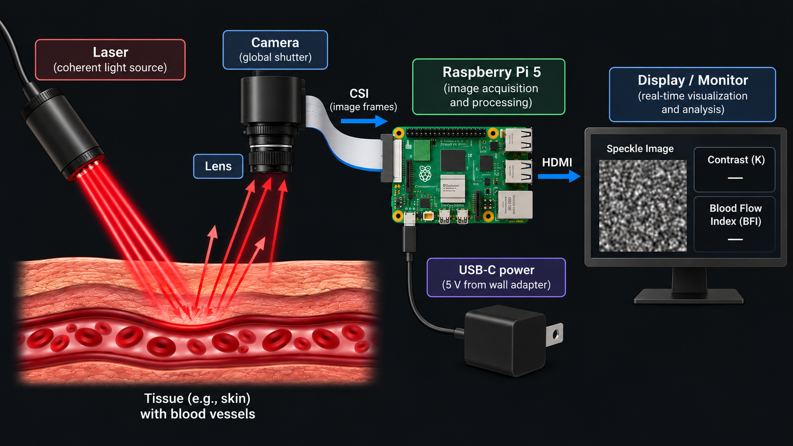
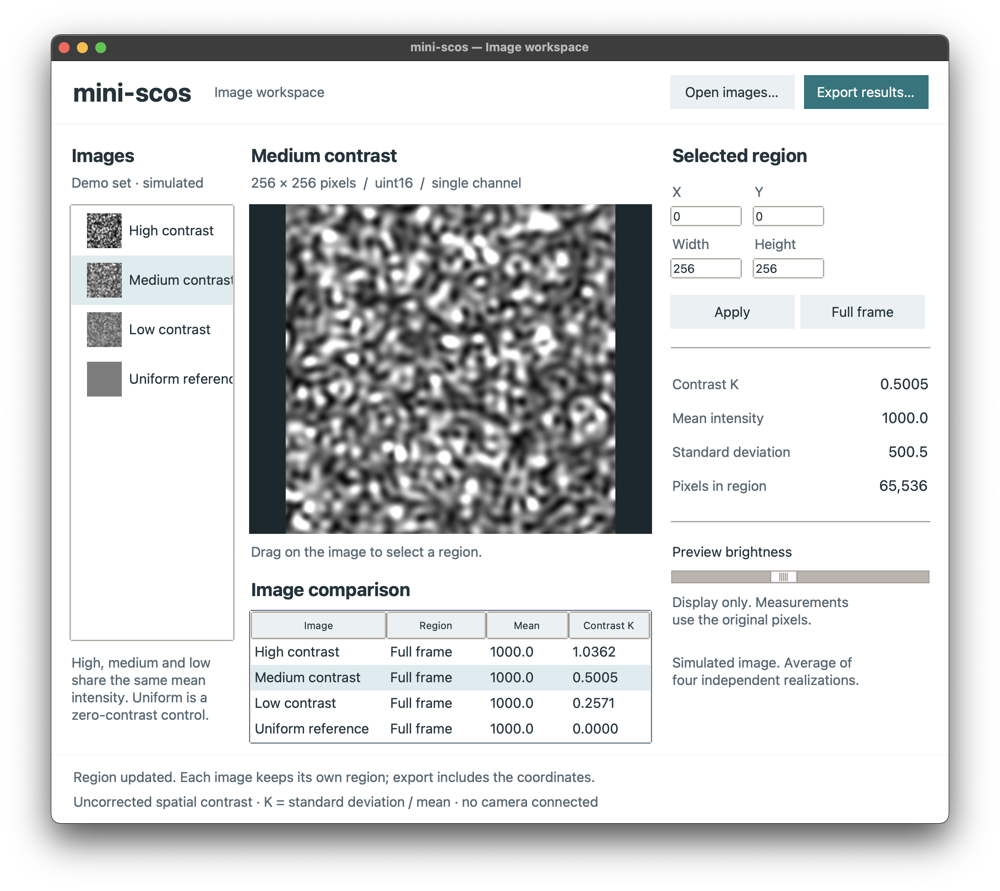

# mini-scos
This project builds a low-cost, DIY version of a SCOS sensor using affordable, hobbyist-grade hardware to demonstrate that the physics behind it can be observed and validated on a modest budget.

### Background ###
#### SCOS ####
Speckle Contrast Optical Spectroscopy (SCOS) is an optical technique for measuring both blood flow and volume, which has various advantages over photoplethysmography (PPG) and other imaging techniques in a variety of clinical applications. It uses coherent laser light that, when scattered by blood molecules in tissue, forms a grainy interference pattern which can be measured by a camera sensor. As blood flows, the camera detects how the interference pattern of the detected light changes. Faster blood flow "blurs" the pattern and lowers the image contrast. Capturing and analyzing images with a specific wavelength, exposure time, and other parameters enables the computation of average intensity, contrast, and blood flow index (BFI).

#### System Overview ####


## How to reproduce this project ##
Check the hardware and software requirements to get started. See /docs for detailed documentation.

The [contrast-analysis tool](software/README.md) runs on a laptop or Raspberry Pi OS. Start with its simulated example to produce a CSV and plot; camera capture and hardware validation are still pending.

## Running the demo application without hardware
You can view more detailed documentation in the [contrast-analysis tool](software/README.md) README. 
To get started, install [Git](https://git-scm.com/downloads) and [uv](https://docs.astral.sh/uv/getting-started/installation/), then open a terminal (PowerShell on Windows):

```sh
git clone https://github.com/ebf-hue/mini-scos.git
cd mini-scos/software
uv run --locked --managed-python ui.py
```

The window opens with four simulated images ready to inspect. No camera or laser is needed. The first run downloads Python and dependencies; you do not need to choose or activate a Python environment.



See the [setup and usage instructions](software/README.md#fresh-clone-setup) for macOS, Windows, Raspberry Pi OS, headless analysis, and troubleshooting. The uv desktop launch and tests have been checked on macOS; Windows and physical Pi testing are still pending.

## CAD concepts

The [CAD folder](cad/README.md) contains Fusion-compatible STEP assemblies, editable generators, and previews for an adjustable bench fixture and an open arm-saddle concept. These are unprinted designs; physical fit and optical performance remain untested.

## Team ##
- Elena Berrios eberrios@bu.edu
- Sean O’Connor ssoc@bu.edu
## Acknowledgements and AI ##
Generative AI tools were used to draft images and text.
