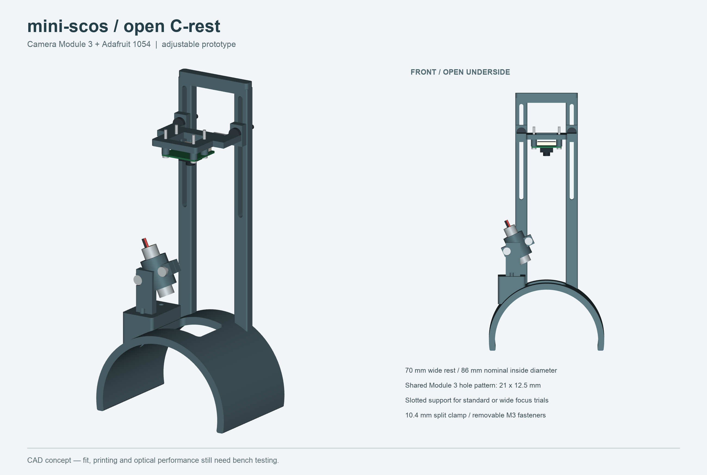

# Open C-rest — Camera Module 3

A generic, wide, open-bottom rest with a raised Camera Module 3 carrier and a separate split clamp for the Adafruit 1054 laser. This revision replaces the earlier HQ-camera proxy and external telephoto lens with the compact Module 3 board and its integrated lens. It is an unprinted mechanical prototype.



## Files

- [Assembly STEP](exports/assembly.step): named solids for importing into Fusion 360; no native Fusion feature history or assembly joints. Fusion itself has not been used to validate the import.
- Individual STEP and STL files: [rest](exports/c_rest.stl), [camera carrier](exports/camera_carrier.stl), [laser cradle](exports/laser_cradle.stl), [laser cap](exports/laser_cap.stl). STLs retain assembly coordinates; orient each part in the slicer.
- [Dimensioned CADCraft drawing](exports/dimensions.dxf) and [SVG](exports/dimensions.svg): rest cross-section and camera mounting pattern. Generated in a separate headless CADCraft session, leaving the desktop drawing untouched.
- [Parameters](parameters.json), [generator](build.py), [validation](exports/validation.json), [exploded view](exploded.png), [nominal arm reference](on_arm.png).

## Geometry

| Feature | Nominal dimension |
|---|---|
| Rest | 70 mm along arm; R43 inside, R48 outside |
| Open underside | Lower edges at Z = −8 mm; approximately 199° shell |
| Arm clearance | 86 mm nominal inside diameter; generic circular section, not a wearer fit |
| Optical window | 32 × 30 mm through top of shell |
| Camera board | 25 × 23.862 mm, four holes on 21 × 12.5 mm centres |
| Camera holes | 2.4 mm printed clearance for M2; 6 mm rear component clearance |
| Height adjustment | Two 3.4 mm slots, 80 mm overall length; M3 bolts and washers |
| Lens-to-target adjustment | Approximately 55–132 mm with the standard lens envelope; pictured at 110 mm |
| Laser | Adafruit 1054, nominal Ø10 × 31 mm; 10.4 mm split-clamp bore |
| Laser direction | Fixed 25° from vertical; slide/rotate laser within clamp before tightening |

The camera board is mounted lens-down beneath the carrier. Its rear connector has 6 mm of clearance to the carrier and a free cable exit. The rear portal is integral with the rest. A pair of bolts clamps the carrier tabs to the portal slots, preventing rotation about a single bolt. The laser cradle bolts to a raised landing; its separate cap clamps around the barrel with two M3 bolts. These are through-holes, not printed threads or heat-set insert pockets.

The standard and wide Module 3 share the board mounting pattern. The reference model shows the standard lens; the wide version has a different optical envelope. Height adjustment accommodates the published minimum focus distances (standard 100 mm, wide 50 mm), but focus and speckle sampling still need testing. The lowest setting has little margin above the wide camera's minimum; start higher. Lens diameter, aperture and image processing differ from the IMX296 setup, so mounting compatibility does not establish SCOS performance.

## Assembly and first print

Print one of each of the four parts. Start with a small bore/hole coupon or just the laser cap before the large rest. The rest/portal envelope is approximately 96 × 70 × 212 mm; check the slicer's actual orientation and support needs. A side orientation may improve the portal's strength but needs supports for the shell. PETG is a reasonable prototype material; no strength, comfort or skin-contact suitability has been tested.

Use four M2 through-bolts/nuts with suitable small washers for the camera (approximately 16–18 mm length), two M3 bolts/nuts with broad washers for height adjustment (approximately 18–20 mm), two M3 bolts/nuts for the laser cap (approximately 16–20 mm), and two M3 bolts/nuts for the landing (length depends on its curved underside; measure in the slicer). Check actual grip lengths and screw-head clearance before ordering. No fastener should project into the arm space. Add removable soft contact pads if needed, then remeasure the target height.

The pictured arm is only a clearance cylinder. Body shape, padding, stability and repeated placement remain untested. There is no strap or clamping pressure adjustment. The open design does not provide laser containment or establish safe skin/eye exposure for the 5 mW source; initial illuminated tests belong on an inanimate target with appropriate beam control.

## Sources

- [Raspberry Pi Module 3 mechanical drawing](https://datasheets.raspberrypi.com/camera/camera-module-3-standard-mechanical-drawing.pdf): board, hole pattern, optical-axis offset and standard lens envelope. The camera solid is a local dimensional reconstruction, not an official STEP model; minor electronic details are simplified.
- [Module 3 product brief](https://datasheets.raspberrypi.com/camera/camera-module-3-product-brief.pdf): standard/wide focus limits. [Product specifications](https://www.raspberrypi.com/products/camera-module-3/) list both variants.
- [Adafruit 1054 specifications](https://www.adafruit.com/product/1054): module dimensions and electrical/optical ratings. The manufacturer [laser STEP](https://github.com/adafruit/Adafruit_CAD_Parts/tree/main/1054%20Laser%20Diode) is copied from the earlier repo concept with its [MIT notice](sources/Adafruit_LICENSE.txt). The printed clamp dimensions come from the product specification.

## Rebuild

```sh
uv venv --python 3.12 /tmp/mini-scos-c-rest-env
uv pip install --python /tmp/mini-scos-c-rest-env/bin/python -r requirements.txt
/tmp/mini-scos-c-rest-env/bin/python build.py
python3 build_drawing.py  # optional: requires cadcraft-cli
```

Run in this folder. VTK needs a working graphics backend for preview renders. `build.py` checks valid solids, one connected solid per printed part, pairwise printed-part intersections, clearance to the reference laser/PCB/lens/connector/arm and STEP reimport. Those checks do not establish printability, hardware fit, cable bend radius, loaded stiffness, optical focus, speckle contrast or blood-flow sensing. Change parameters and rebuild to make a different rest size; dimensions derived from the fixed landing/portal should be rechecked after large changes.
