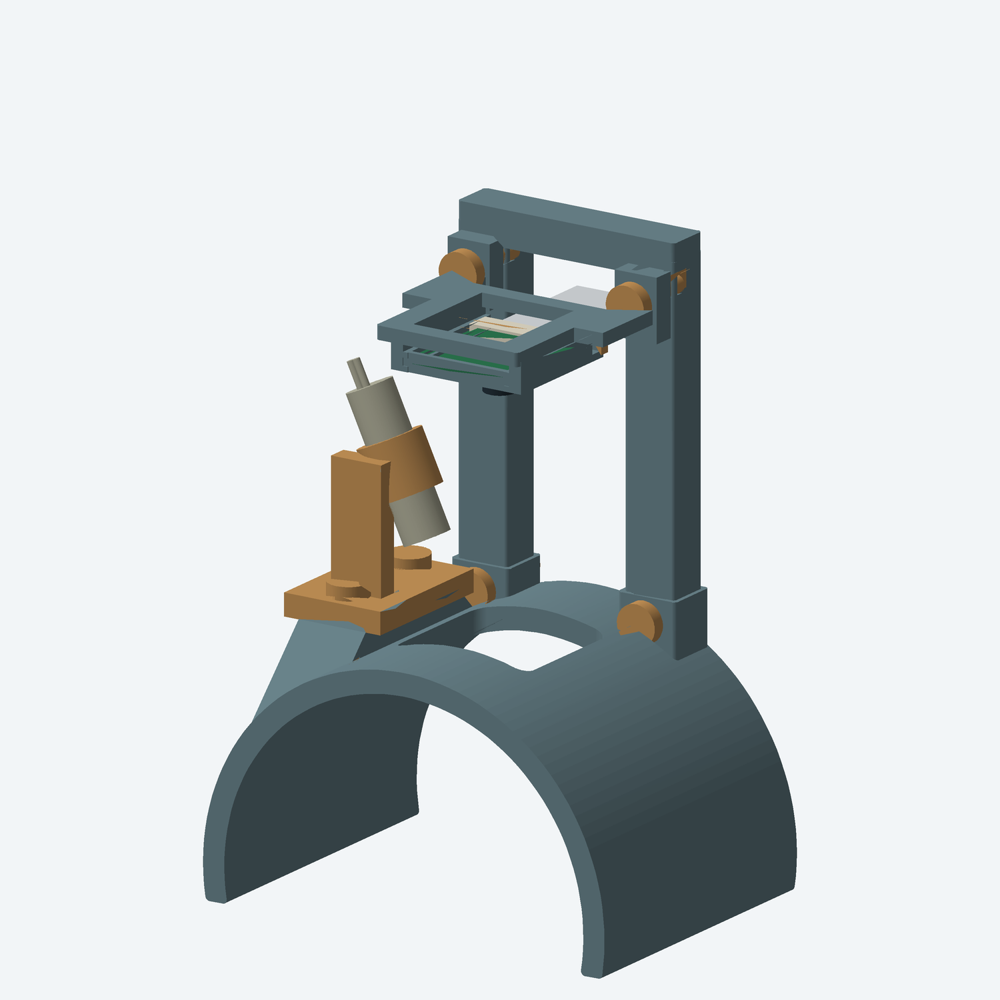

# Printed-joint C-rest

Revised for fabrication: a wide C-rest, interchangeable short/tall supports, a sliding camera cassette, a flexible laser clip and printed locking pins. **No metal screws, nuts, inserts, glue or purchased mounting hardware are required by this design.** The camera, laser, cable and Pi remain separate electronic components.



## Camera height

The previous frame provided more adjustment than this prototype needs. Raspberry Pi specifies minimum focus distances of **100 mm for the standard Module 3 and 50 mm for the wide version** ([official product brief](https://datasheets.raspberrypi.com/camera/camera-module-3-product-brief.pdf)).

- **Compact / wide:** lens nominally 55 mm above the target; use [the short support](exports/tower_wide_55mm.stl) and [wide assembly STEP](exports/assembly_wide.step).
- **Standard:** nominally 105 mm above the target; use [the tall support](exports/tower_standard_105mm.stl) and [standard assembly STEP](exports/assembly_standard.step).

Identify the lens variant before choosing the support. A standard camera placed at 55 mm is outside its published focus range. A substantially lower device would require a different optical arrangement. The shared cassette clears a conservative wide-lens envelope; it does not alter the lens or guarantee focus/speckle performance. The mechanical camera envelope and published focus specification are different evidence: actual focus must be checked on the bench. Both distances reference the nominal target at Z=43, so padding and arm shape change them.

## Print list

STLs are **separate, oriented parts with their lowest point at Z=0 within meshing tolerance**. Import without automatic reorientation. STEP parts retain assembly coordinates for Fusion 360; no native feature timeline or Fusion import test is provided. [Download the print pack](print_pack.zip) for the STLs, STEP assemblies and these notes together; rebuilding requires the repository sources.

| Part | Quantity | Print file |
|---|---:|---|
| Open rest: 70 mm wide, R43 inner / R48 outer | 1 | [rest.stl](exports/rest.stl) |
| Support for your camera variant | 1 | [55 mm wide](exports/tower_wide_55mm.stl) OR [105 mm standard](exports/tower_standard_105mm.stl) |
| Camera edge cassette | 1 | [camera_cassette.stl](exports/camera_cassette.stl) |
| Sliding camera keeper | 1 | [camera_keeper.stl](exports/camera_keeper.stl) |
| Removable laser clip | 1 | [laser_clip.stl](exports/laser_clip.stl) |
| Split locking pin, 20 mm shaft | 4 + spares | [locking_pin_20mm.stl](exports/locking_pin_20mm.stl) |
| Split laser pin, 19 mm shaft | 2 + spares | [laser_pin_19mm.stl](exports/laser_pin_19mm.stl) |
| Fit coupon | 1 first | [fit_coupon.stl](exports/fit_coupon.stl) |

Use PETG for the flexible jaws, keeper and pins; PETG is also the baseline for the rest/support. Start with a 0.4 mm nozzle, 0.2 mm layers and four perimeters. Use solid pins and keeper; 25–35% infill is a starting point for the larger parts. Fit/stiffness still require a physical print.

The rest is oriented on its rear axial face, and the supports lie flat. The rest's laser landing has sloped transitions to reduce overhangs. **Inspect the sliced toolpaths:** use removable supports on the laser clip's overhangs and the cassette's projecting ears/upper frame as needed. These are conventional supported FDM parts, not a claim of support-free printing. Keep supports out of PCB guide slots and the laser bore where possible; carefully remove remnants before assembly. All individual envelopes are below 220 mm, but check usable build area, brim and printer clearances. [Separated parts preview](print_parts.png) is a catalogue view, not a single build plate layout.

## Assembly

1. Print the coupon and spare pins first. Check the nominal 10 mm laser bore and the 8.4 × 6.4 mm socket. The split pin tapers from 4.5 to 4.0 mm in a 4.3 mm hole, deliberately creating a small compliant press fit. Printer compensation may be necessary. Do not force tight pins into the large parts.
2. Insert the chosen support into the rest's two sockets and push two long pins through the aligned transverse holes. Socket clearance is 0.2 mm per side; the pins retain the support.
3. Attach the cassette to the support with two more long pins. Feed the ribbon cable out of the rear opening. Slide the unpowered camera into its edge tracks, stopping against the front wall. The 1.72 mm slot accommodates the nominal 1.12 mm PCB with clearance; it does not squeeze the board or lens.
4. Insert the crosswise keeper behind the board. Its end stop and small retention nib limit travel. Check that it cannot slide out during normal handling; test the small part first and adjust its fit if necessary. The ribbon exits above the keeper.
5. Pin the laser clip's foot to the raised landing using the two short pins. Slide the nominal Ø10 mm Adafruit 1054 barrel **axially** into the clip, lens end first. The slit allows a little compliance; it is not a mouth for snapping the whole barrel in sideways. It is a friction clip, not an aiming adjustment. Verify retention without power. Bore compensation, jaw stiffness and repeated-use life need testing.

Do not power the camera until its board is secured without contacting components. Confirm that no printed pin or edge projects into the arm space. The arm section is generic, not a wearer fit. Initial illuminated tests belong on an inanimate target with controlled beam paths: this open mount does not establish laser containment or safe exposure.

## Checks and limitations

The generator checks one valid solid per printed part, part size, bed placement, structural-part intersections, camera-envelope clearances and STEP reimport for both configurations. Pins intentionally interfere with their holes to grip and are excluded from rigid collision checks. These checks establish CAD integrity, **not a successful print, measured hardware fit, retention strength or optical performance**. The [validation report](exports/validation.json) records results.

All nine STL files also passed a closed-mesh check ([report](exports/mesh_validation.json)) and sliced successfully in **OrcaSlicer 2.4.2** using a reference Bambu A1 mini 0.4 mm / Generic PETG profile, 0.2 mm layers, four walls, 30% infill and automatic supports ([report](exports/slice_validation.json)). This is a geometry/toolpath feasibility check, not a claim about the printer you own or a physical print. Generated G-code is kept outside the repository and is not part of the print pack. Select your actual printer and filament before slicing. There has been no physical print validation yet.

The Adafruit laser reference is reused from [the preceding revision](../03-c-rest-module3/sources/laser_1054.step), with its [MIT license](../03-c-rest-module3/sources/Adafruit_LICENSE.txt). Nominal dimensions come from [Adafruit 1054](https://www.adafruit.com/product/1054). Camera board dimensions come from the [official drawing](https://datasheets.raspberrypi.com/camera/camera-module-3-standard-mechanical-drawing.pdf). References are simplified packaging envelopes, not exact electronics models.

Rebuild from this folder with Python 3.12 and the [requirements](requirements.txt):

```sh
uv venv --python 3.12 /tmp/mini-scos-c-rest-env
uv pip install --python /tmp/mini-scos-c-rest-env/bin/python -r requirements.txt
/tmp/mini-scos-c-rest-env/bin/python build.py
python3 check_meshes.py
```
