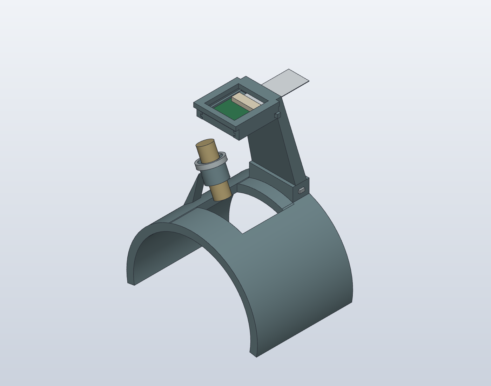

# SCOS arm mount — SolidCraft

**Superseded after physical print feedback:** the connecting laser rib flexed, and the camera could not be loaded into the captive tray. Use the [V2 print-feedback revision](../07-solidcraft-mount-v2/README.md) for replacement rest and camera-support parts. The files here retain the printed V1 design for traceability.

Native SolidCraft model with one tapered rear spine, a slim Camera Module 3 edge tray, and a low laser collar integrated into the wide open C-rest. The five assembled mounting parts are printed: **rest, spine/tray, camera keeper, flat locking key and laser compression band**. No screws, nuts or inserts are specified.



## Open and print

- **A1 mini / 0.4 mm / PLA:** use the [single-plate Bambu Studio project](bambu/mount_wide_single/mount_wide_single.3mf), or the [standard-camera alternative](bambu/mount_standard_single/mount_standard_single.3mf). Each has all five mount parts on one 180 mm plate: camera support on its broad rear face, rest on its axial end, retainers flat. Tree supports, four walls and 30% infill are saved in the project. Estimated compact print: 2 h 41 min / 69.5 g; standard: 2 h 49 min / 76 g. Select your PLA AMS slot before printing. Nothing has been sent to the printer.
- [Native SolidCraft model](mount.solidcraft): editable feature history; change the favourite `working_distance` parameter to **55 mm for the wide camera** or **105 mm for the standard camera**. The model opens at 55 mm.
- [Print pack](print_pack.zip): all STLs, both assembly STEP files, native model, instructions and validation reports.
- [Compact assembly STEP](exports/assembly_wide.step) / [standard assembly STEP](exports/assembly_standard.step): for Fusion or other CAD tools. STEP retains geometry, not SolidCraft's native feature history.

| Print | Quantity | File |
|---|---:|---|
| Wide open rest with integral laser collar | 1 | [Rest.stl](exports/Rest.stl) |
| Single spine and camera tray | 1 | [Wide, 55 mm](exports/SpineCamera.stl) **or** [Standard, 105 mm](exports/SpineCamera_standard.stl) |
| Camera keeper | 1 | [Keeper.stl](exports/Keeper.stl) |
| Concealed flat locking key | 1 | [LockingKey.stl](exports/LockingKey.stl) |
| Laser compression band | 1 | [LaserBand.stl](exports/LaserBand.stl) |
| First-print collar coupon | 1 first | [FitCollar.stl](exports/FitCollar.stl) |

The Bambu projects above supersede the earlier upright spine orientation in the raw native exports. Their support is rotated to place its planar broad rear face on the bed: approximately −104.74° about X for the compact version, −98.10° for standard. Bed contact is approximately 1,730 mm² and 3,155 mm² respectively. Reoriented spine STLs are under `bambu/oriented/`; the CAD assembly itself is unchanged. Tree supports are included for remaining overhangs. Keep supports out of the PCB grooves, small cable opening and laser bore where possible and inspect the preview. The band, keeper and key lie flat; the rest prints on its axial end.

PETG is the baseline material for the flexible collar and retention parts. The reference slicing check used a 0.4 mm nozzle, 0.2 mm layers, four walls, 30% infill and automatic supports. Use solid infill on the small retainers if desired. These are starting settings, not validated settings for your printer. The largest part fits inside a 180 mm nominal envelope; allow room for brims and supports.

**Print the coupon and band before the large rest.** The coupon reproduces the 14 mm outside / 10.2 mm inside split collar. The band has a 13.7 mm inside diameter and 17 mm outside diameter. Its small designed overlap with the collar is intended to compress the slit and grip the nominal 10 mm laser barrel. Test unpowered retention and insertion force. If the fit is too tight or loose, adjust the collar/band dimensions and repeat this small print rather than forcing the full mount. No elastic deformation, retention force, fatigue or creep calculation has been validated.

## Assembly

1. Slide the spine's 20 × 6 mm tenon into the 20.4 × 6.4 mm socket on the rest. Push the small flat tapered key through the aligned transverse slots to retain it. It is a friction wedge, not a threaded fastener.
2. Slide the unpowered camera board into the side tracks. The nominal 1.12 mm PCB has a 1.72 mm guide gap. Insert the crosswise keeper behind its rear edge. Check the keeper's fit and retention nib before relying on it.
3. Route the ribbon backwards through the 17 × 2.1 mm opening in the spine. Do not pinch the connector or put a sharp fold in the cable; the model only checks a straight cable envelope, not a bend radius.
4. Slide the laser barrel axially into its collar, lens end first. Slide the compression band over the free upper end of the collar to tighten it. Keep the laser's lens adjustment and wire exit accessible. Verify retention without power.

The shown short support requires the wide camera's published 50 mm minimum-focus capability. The standard variant is specified from 100 mm; its taller support is included. See the [Raspberry Pi product brief](https://datasheets.raspberrypi.com/camera/camera-module-3-product-brief.pdf). Actual focus, speckle sampling, skin distance and image quality require bench testing. The generic rest is 70 mm wide with R43 inside/R48 outside, approximately a 200° C-section. It is not a wearer scan or a validated body-contact fit.

## Collision and print checks

The native `inspect.interference` checks cover all 12 solid bodies, including the simplified camera, straight cable, laser and R41 nominal arm gauge. Both 55 mm and 105 mm configurations were checked, then the model was restored to 55 mm. **There are no unintended reported intersections and no unchecked pairs.**

Three intentional press-fit contacts are retained and explicitly reported:

| Pair | Nominal overlap volume |
|---|---:|
| Rest / locking key | 2.682 mm³ |
| Spine / locking key | 1.765 mm³ |
| Rest collar / compression band | 15.181 mm³ |

These overlaps specify preload in a flexible printed joint; they do not simulate its deformed shape or establish that the fit will work on a particular printer. [Native collision report](exports/collision_checks.json).

All 17 sketches are fully constrained; all 55 native features are free of errors and warnings. The first C-section volume was compared to its analytic annular-sector volume. All seven STL files passed closed-mesh and bed-placement checks, and all seven sliced successfully in OrcaSlicer 2.4.2 using a **reference** Bambu A1 mini / Generic PETG profile. See [model health](exports/model_health.json), [mesh checks](exports/mesh_validation.json) and [slicing checks](exports/slice_validation.json). This does not identify your printer or establish physical print quality. G-code is kept outside the repository and is not supplied in the print pack.

The laser is a nominal **Ø10 × 31 mm packaging envelope**, based on [Adafruit 1054](https://www.adafruit.com/product/1054). The camera is a simplified mechanical envelope based on the [Module 3 drawing](https://datasheets.raspberrypi.com/camera/camera-module-3-standard-mechanical-drawing.pdf). Fine components, wiring, lens adjustment details and manufacturing tolerances are not fully represented. Initial illuminated tests should use an inanimate target with controlled beam paths; the open mount does not establish laser containment or safe exposure.

## Rebuild

The model is authored as native sketches, extrusions, a loft and cuts through SolidCraft's **stdio MCP**, not imported mount geometry. [build_commands.json](build_commands.json) is the replayable command script; [mount.json](mount.json) is the plain JSON native design.

With SolidCraft installed, run from this folder:

```sh
python3 build.py
python3 check_meshes.py
```

Set `SOLIDCRAFT_CLI` if the executable is not on PATH or at the usual macOS application path. Rebuilding uses a separate headless document and does not replace an open desktop document. The script builds both configurations, checks collisions and exports the native model and printable parts. Slicer validation is a separate reference check, not automatically rerun by this script. Native `.bak` save backups and intermediate command logs are ignored by Git.

Run `python3 slice_bambu.py` on this Mac to rebuild the A1 mini PLA projects and single-plate layouts. The script resolves the bundled preset inheritance and G-code templates, records project overrides so Studio retains supports on open, applies the rear-face-down orientations, packs all five parts onto one plate, and re-slices. Earlier two-plate files are intermediate inputs; use the `_single.3mf` outputs.
