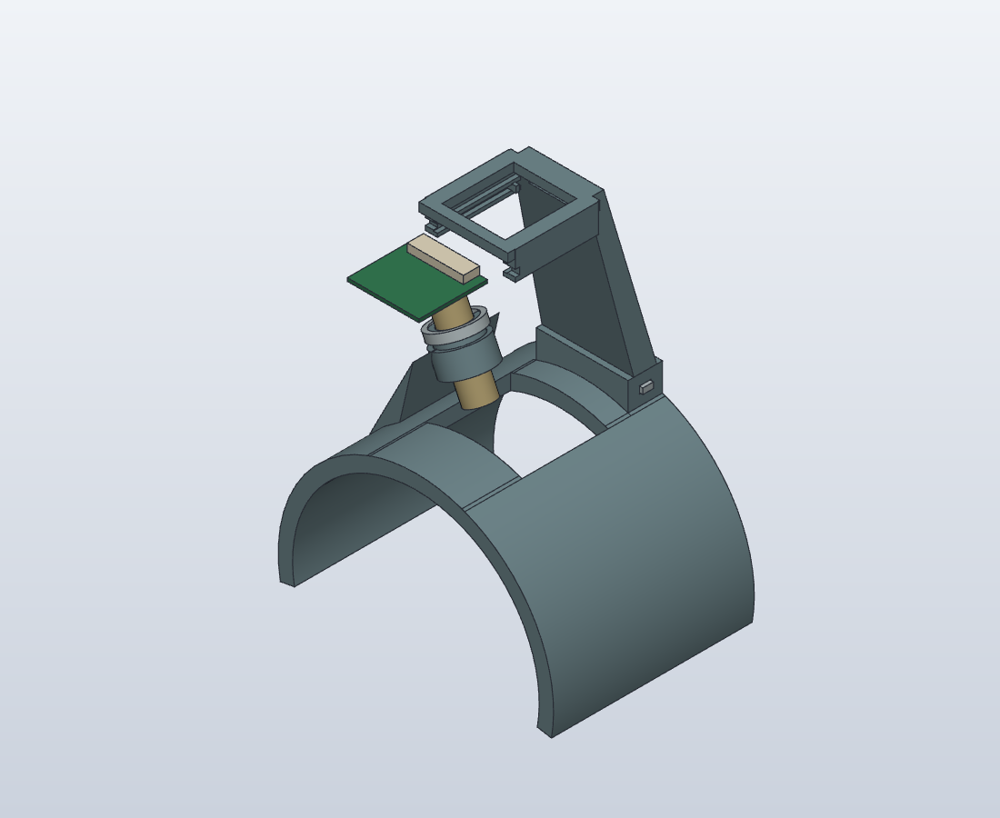

# SCOS mount V2 — print-feedback revision

V1's laser root was too narrow, and the camera tray had no usable loading path: its rear spine obstructed rear entry while the fixed front stop obstructed front entry. Static collision checks did not catch that assembly failure. This revision addresses both reported problems.

## What to reprint

Reprint **only the rest and the spine/camera tray**. Reuse V1's laser compression band, flat locking key and camera keeper. Their physical geometry is unchanged; the keeper moves to the front in the assembly.

- [One A1 mini PLA replacement plate — 55 mm wide-camera version](bambu/mount_wide_single/mount_wide_single.3mf)
- [One A1 mini PLA replacement plate — 105 mm standard-camera version](bambu/mount_standard_single/mount_standard_single.3mf)
- [Native SolidCraft model](mount.solidcraft)

The plates contain two replacement parts, with the rest on its axial end and the camera support on its planar rear face. They use a 0.4 mm nozzle, 0.2 mm layers, four walls, 30% infill and tree supports, with the complete bundled A1 mini/Generic PLA profiles. Select the PLA AMS slot before printing. No print is sent automatically.

## Laser support

The connecting cradle is now **30 mm wide instead of 6 mm**, spreads onto a wider section of the rest, and supports both sides of the collar. The lower collar outside diameter grows from 14 to 17 mm, while the free upper end retains the original compression-band interface. The laser's nominal 10 mm barrel still has a 10.2 mm bore.

These are geometric reinforcements, not a measured strength result. There has been no load test or physical fit test of V2 yet. The printed V1 feedback establishes that the earlier root was inadequate; this wider design still needs physical evaluation.

## Insert the camera from the front

1. Leave the front keeper **out**. Disconnect the ribbon while loading.
2. Hold the camera **lens downward**, ribbon connector toward the rear spine, and slide it into the open front of the tray between the edge guides.
3. Seat it at the two rear stops. The guides are 25.8 mm apart for a nominal 25 mm board; the vertical guide gap remains 1.72 mm for the nominal 1.12 mm PCB.
4. Slide the original keeper crosswise into the **front** guide to prevent the board sliding back out. Do not force a tight keeper; physical printer compensation may still be needed.
5. Feed and connect the ribbon through the rear opening, using the top access window to operate the connector latch. Cable bending/hand access are not represented by the straight-envelope collision check.



## Checks

The native SolidCraft model checks the full **continuous 40 mm front insertion path** for the PCB, lens housing, lens and rear connector, with the keeper and ribbon removed. The check uses exact swept boxes for rectangular components and a conservative swept box around the circular lens. X/Y envelopes are padded by 0.2 mm per side and Z envelopes by 0.1 mm. A clear conservative envelope establishes clearance for the nominal rigid module along that path, rather than only checking sampled positions.

Both 55 and 105 mm configurations pass that insertion check. [Wide-path report](exports/assembly_path_wide.json) / [standard-path report](exports/assembly_path_standard.json). These are geometry checks, not a physical assembly trial.

The assembled model also checks the camera, cable, laser and R41 arm gauge. The only intended intersections are the flat key's two friction contacts and the collar/compression-band press fit. [Static collision report](exports/collision_checks.json). Camera/connector reference envelopes are simplified; they do not include every small electronic component or cable-handling detail.

Closed-mesh and bed-placement checks are in [mesh_validation.json](exports/mesh_validation.json). Bambu projects are sliced before delivery; native model sources and STEP exports are retained beside the print files. The standard variant retains V1's height difference; this revision does not change camera optics or establish SCOS performance.

## Rebuild

```sh
python3 build.py
python3 check_meshes.py
python3 slice_bambu.py
```

SolidCraft and Bambu Studio are required at their installed macOS locations; `SOLIDCRAFT_CLI` can override SolidCraft's path. Rebuilding uses a separate headless SolidCraft MCP document. The native feature history remains in `mount.solidcraft` and its plain JSON counterpart; `build_commands.json` is the replayable native command script. Re-slicing keeps both replacement parts on one A1 mini build plate.
