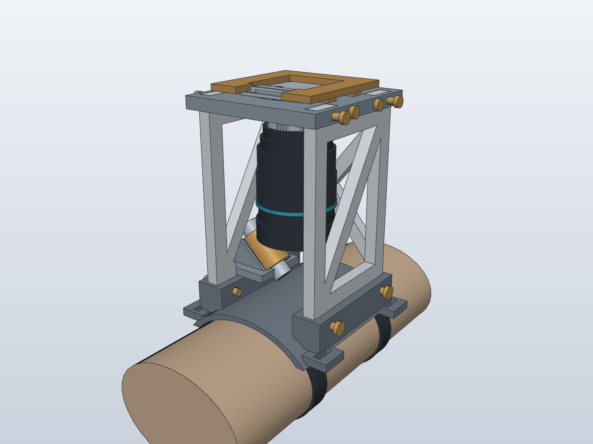
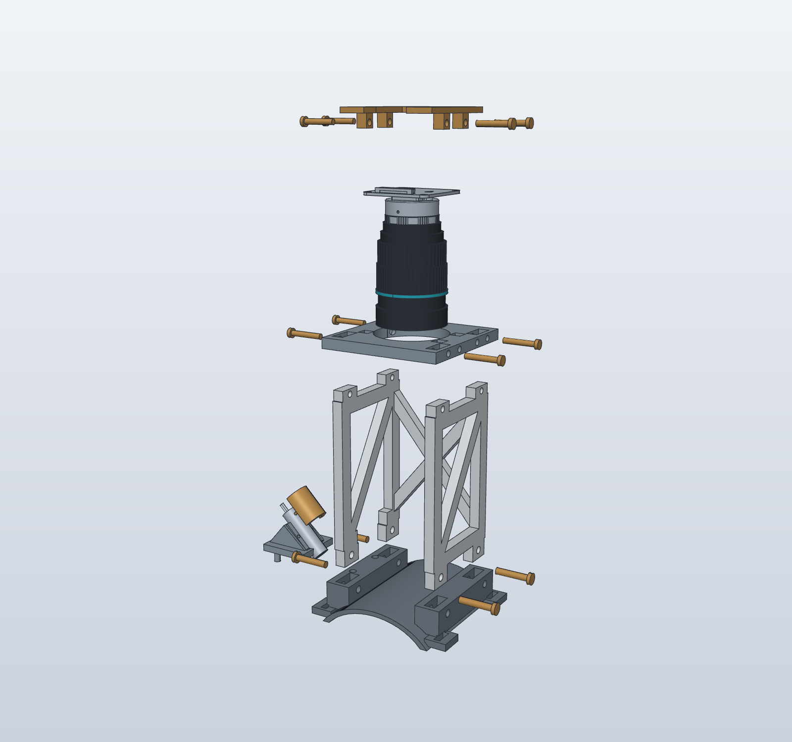

# Wrist Tower: Mechanical Assembly Study

This replaces the earlier free-form supports with a defined frame and assembly sequence for the user-confirmed **IMX296 With CS.stp** camera. The camera points straight down at the wrist. This is a mechanical study, not a print release or a validated SCOS instrument.



## Design Basis

| Item | Dimension or decision |
| --- | --- |
| Camera source | Supplied STEP, confirmed by the user as their camera |
| Board envelope | 39 × 39 mm; nominal 1.6 mm PCB thickness |
| Existing camera holes | 34 mm square pattern, 2 mm hole diameter in STEP; not used for printed fasteners |
| Lens clearance | Full Ø39 × 50 mm envelope plus nominal 5.026 mm C-to-CS allowance |
| Carrier | 70 × 70 × 6 mm; Ø42 mm opening for top loading with lens installed |
| Frame | 6 mm sections, side diagonals, integral rear X brace |
| Base | Curved wrist saddle; four keyed frame sockets; two strap stations 60 mm apart |
| Tower position | Camera reference origin 104 mm above nominal wrist top |
| Lens-front clearance | 31.774 mm above the nominal wrist surface |
| Retention | Removable corner-retaining frame; 12 headed printed structural/retainer cross-pins |
| Laser | Independent base-mounted bracket, split Ø10.6 mm cradle, two gussets, removable cap; fixed 45° nominal axis |

The exact supplied camera is embedded in the assembly, including its open PCB shells. The lens appearance is a dimensioned recreation from the [PiShop product photo and specifications](https://www.pishop.us/product/16mm-telephoto-lens-for-raspberry-pi-hq-camera-cs/), not supplier lens CAD. Full-envelope clearance checks use a plain Ø39 × 50 mm cylinder rather than the cosmetic rings. The adapter is also an envelope. Actual knob, thread, adapter, focus-travel and finger-access dimensions still need measurement.

## Load Path and Joints

The lens loads its camera assembly; the board is supported on approximately 168.5 mm² of actual board-face contact area near its edges/corners. The removable retainer prevents lift-out. The carrier transfers load into the two braced side frames; four rectangular feet locate those frames in the wrist base. Cross-pins prevent the keyed joints withdrawing vertically. A rear X brace connects the side frames against racking. The two straps anchor the base at separated stations.

The left frame has a defined lower opening for the separate laser bracket. That bracket seats on the base rather than borrowing a thin connection from the camera frame. Its foot, two planar gussets and lower split cradle have an explicit load path. Laser angle is currently fixed; there is no claim of an adjustment mechanism.

Headed pins still require a pullout/detent test. Clearance alone does not prevent them vibrating out. The corner retainer avoids relying on fragile printed pins through the camera's 2 mm holes. PCB bending, clamp force and the camera's own metal-to-board attachment still need physical assessment under the lens weight.

A simple design scenario uses 0.20 kg total supported mass and 3 g lateral acceleration: 5.89 N force, 0.612 N·m at the nominal camera height, and a 10.2 N strap couple over 60 mm. These are load assumptions to guide testing, not FEA or a demonstrated capacity. No strength or fatigue rating is claimed.

## Assembly



1. Seat the frame's four rectangular feet in the base sockets; insert the four larger base cross-pins.
2. Seat the camera plate on the frame's upper keys; insert the four plate cross-pins.
3. With the retainer removed, lower the assembled camera, adapter and lens vertically through the Ø42 mm plate opening. The camera board lands on the plate; the lens remains attached.
4. Lower the corner-retaining frame over the PCB. Its four feet enter their sockets outside the camera board. Insert its four cross-pins. The front notch leaves the ribbon connector accessible.
5. Seat the separate laser bracket on its locating pegs, place the laser with aperture toward the skin and fit the removable cap. Peg grip and cap removal force require testing.

The exploded image separates parts for identification; it is not an animation proving every insertion path. The laser aperture nominally aims at the wrist below the camera axis. Neither the arm reference nor a collision-free model establishes laser exposure suitability.

## Checks Performed

- Six major printed parts are valid, connected single solids.
- Zero nominal volume overlap between those parts and the complete camera solids plus a conservative PCB envelope, adapter envelope, lens envelope, laser or wrist reference.
- Zero major-part intersections and zero structural/retainer cross-pin intersections.
- Eleven exact-solid samples over a 100 mm vertical camera-loading path, with the retainer removed, found no collisions. This is a sampled path, not a continuous sweep or an ergonomic check.
- All 515 source camera faces were also checked against the plate: zero penetrations, with 168.5 mm² of intended board support contact.
- Dimensions and checks are in `mechanical-check.json`, `joint-check.json`, and `camera-surface-check.json`.

The frame has not been sliced. Support placement, manufacturing tolerances, pin retention, stiffness, camera/PCB loading and physical fit remain open.

## Optical Height Is Unresolved

The compact position above is chosen to evaluate packaging and assembly. The supplier lists a **0.20 m minimum object distance** for this lens. Approximately 32 mm from its front to skin is not a demonstrated usable optical configuration. The frame height is a parameter in `build.py`, but changing it requires rebuilding and rechecking the geometry; the shown tower does not telescope.

Before making a complete print, test the actual camera/lens against an inanimate target at several distances and exposure/aperture settings. Establish whether useful focus and speckle contrast are available at the compact position, need extensions/other optics, or require a substantially taller tower. The current geometry must not be described as a working blood-flow sensor.

## Files and Rebuild

- `tower-mechanical.solidcraft`: SolidCraft assembly of imported solids.
- `tower-mechanical.step`: portable assembly for Fusion or another CAD tool.
- `parts/`: individually named components, including hardware references.
- `build.py`: explicit frame, joint, camera and laser dimensions; no editable SolidCraft feature timeline is implied.
- `sources/`: user-supplied camera, Adafruit laser (MIT licence included), and cosmetic lens reconstruction.

```sh
uv run --python 3.12 --with cadquery python cad/15-tower-mechanical/build.py
uv run --python 3.12 --with cadquery python cad/15-tower-mechanical/verify_joints.py
uv run --python 3.12 --with cadquery python cad/15-tower-mechanical/check_camera_surfaces.py
uv run --python 3.12 --with cadquery python cad/15-tower-mechanical/render_exploded.py
```

Requires SolidCraft's CLI for saving and screenshots. The wrist is a simple 70 × 50 mm elliptical reference, not a measured anatomical model.
