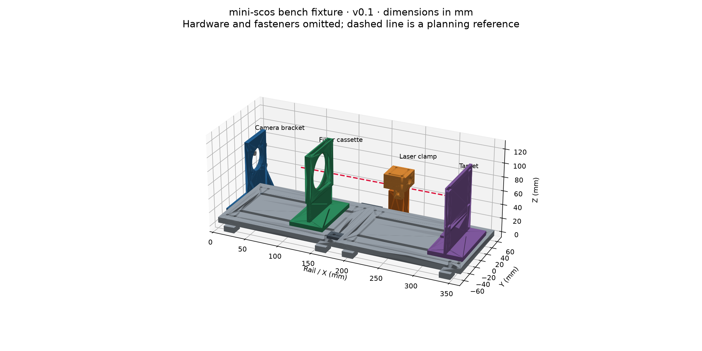

# CAD concepts

CAD studies for exploring mini-scos hardware. Units are millimetres.

| Design | Use | Open in Fusion |
|---|---|---|
| [Sliding dovetail wrist tower](tower-dovetail/README.md) | IMX296 wrist assembly with slide-in camera retainer, braced frame and pin-free joints; physical fit and optics unverified | [Native SolidCraft](tower-dovetail/tower-dovetail.solidcraft) / [STEP](tower-dovetail/tower-dovetail.step) |
| [Bench fixture](bench-fixture/README.md) | First inanimate-target experiments with adjustable camera, laser and filter positions | [Assembly STEP](bench-fixture/exports/bench_fixture.step) |
| [Open arm saddle](arm-cuff-concept/README.md) | One-sided mounting concept shown in the presentation | [Assembly STEP](arm-cuff-concept/exports/v04/open_arm_saddle.step) |

STEP files preserve solids and component names, but not a native Fusion feature timeline. Generators and rebuild instructions are included in each folder. Open the assembly first; individual parts are provided separately.

The bench fixture is the starting point. The compact arm concept has an unresolved close-focus spacer, and its camera is an HQ-camera visual proxy rather than exact IMX296 geometry. Both assume the selected 16 mm lens; the existing hardware shortlist still describes the earlier 6 mm option.

Geometric checks do not establish printability, measured fit, optical focus, laser containment or blood-flow sensing. No physical prototype or measured performance is claimed. These designs contribute to [mounting issue #10](https://github.com/ebf-hue/mini-scos/issues/10); repeated-placement measurements remain outstanding.

The dovetail tower uses the user-confirmed IMX296 camera STEP and a dimensioned lens visualization. Its compact lens-to-wrist spacing has not been shown to focus; start with the included joint fit coupons and establish optical working distance before a full print. See its [assembly instructions, checks, and screenshots](tower-dovetail/README.md).
