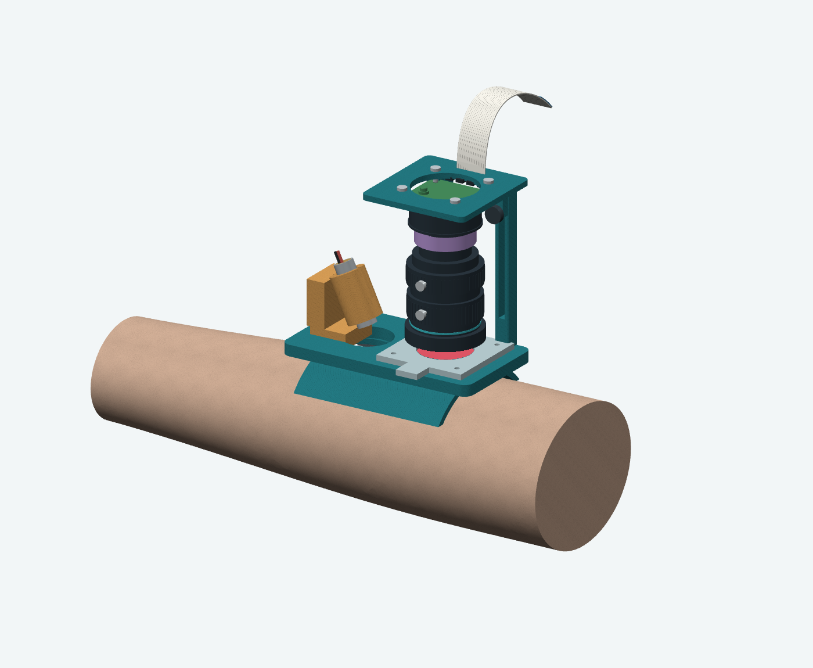

# Open arm saddle concept (V04)

A one-sided curved rest for prototyping on an arm-shaped target. The camera supports, angled laser clamp and removable filter remain exposed. There is no lower cuff or enclosing pod. This is a packaging concept, not a print-ready wearable or validated SCOS sensor.



## Open in Fusion

Upload [exports/v04/open_arm_saddle.step](exports/v04/open_arm_saddle.step) through Fusion's Data Panel, then open the translated assembly. Individual saddle, camera mount, upright, laser clamp and filter-frame STEP files are in the same folder. The nominal forearm reference is separate: [forearm_reference.step](exports/v04/forearm_reference.step).

STEP preserves solid geometry and component names, not native Fusion feature history or assembly joints. No native `.f3d` file or Fusion-import test is provided. Dimensions are in millimetres; the editable source is `build_graphic_v04.py`.

## Dimensions and unresolved questions

- Lens body: nominal 39 mm maximum diameter × 50 mm length, reconstructed from the [supplier drawing](https://www.welectron.com/mediafiles/datasheets/raspberrypi/Raspberry-Pi-HQ-Camera-16mm-Tele-Lens-Datasheet.pdf). Adjustment-ring details and projecting screws are illustrative.
- The [selected 16 mm lens](https://www.pishop.us/product/16mm-telephoto-lens-for-raspberry-pi-hq-camera-cs/) specifies a 200 mm minimum object distance. The pictured purple 9 mm spacer is an unresolved close-focus allowance, not a calculated or purchased adapter. Focus, magnification, sampling and throughput need bench testing.
- The camera is an **HQ-camera visual proxy**, not exact IMX296 geometry. Do not derive fit-critical mounting dimensions from it.
- The smooth forearm is nominal geometry, not a wearer scan. Saddle fit, padding, stability, fasteners, screw access and printability remain untested.
- The white ribbon and blue stiffener illustrate the cable to the external Pi. Cable routing and length are not validated. Surface textures are render-only and are not embossed into the STEP geometry.
- Red gel is a broad red-pass filter, not a narrowband laboratory optic or laser-protection filter. This model is not validated laser containment or an exposure assessment. Start with inanimate targets and the [bench fixture](../bench-fixture/README.md).

## Source geometry and licenses

The two downloaded reference STEP files and their MIT license notices are retained under `sources/`. They are imported as geometry; no downloaded scripts are executed.

| Reference | Source | Use |
|---|---|---|
| Adafruit 1054 laser | [Adafruit CAD Parts](https://github.com/adafruit/Adafruit_CAD_Parts/tree/main/1054%20Laser%20Diode) | Exact module reference; `sources/laser_1054.step` |
| HQ camera | [SRD-1 at b08fc9723898ccbdcf57b126db6fddc09c1b5d5b](https://github.com/MilosRasic98/SRD-1/blob/b08fc9723898ccbdcf57b126db6fddc09c1b5d5b/3D%20Models/SG90%20Gimbal%20Assembly/Raspberry%20HQ%20Camera.step) | Cropped into housing/PCB illustration; `sources/hq_camera_reference.step` |

`sources/SHA256_CURRENT.json` records hashes for those four source/license files. The arm, printed parts, lens reconstruction, padding, cable and fasteners are locally generated geometry. Earlier cuff concepts and their anatomical scans are not part of this contribution.

## Rebuild and validation

From this folder, use Python 3.12 in an isolated environment:

```sh
uv venv --python 3.12 /tmp/mini-scos-cad-env
uv pip install --python /tmp/mini-scos-cad-env/bin/python -r requirements.txt
/tmp/mini-scos-cad-env/bin/python build_graphic_v04.py
```

VTK needs a working rendering backend for PNG output. On macOS the script uses Arial; other systems fall back to Pillow's bundled font.

The script checks individual solids, writes STEP assemblies/parts, and renders `open_saddle_assembled_v04.png`, `open_saddle_detail_v04.png` and `open_arm_saddle_textured.png`. `exports/v04/validation.json` records validity and dimensions. `import_validation.json` records STEP reimport checks. These establish geometric integrity only, not whole-assembly collision clearance, physical fit, print quality or optical performance.
