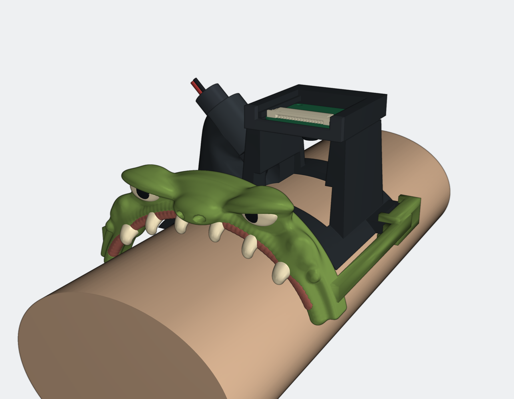

# Sculpted Halloween Monster Attachment

A printable mesh sculpt based on the approved monster concept, with an integrated brow, nose, upper jaw, gums, and six rounded curved fangs. It slides onto the current wrist mount's existing strap ears. The wrist saddle, camera carrier, and laser cradle are unchanged.



This image renders the exported meshes. [The original visual concept](concept-reference.png) is a styling reference, not the manufacturing model. The printable version is a simplified sculpt rather than a literal conversion of every detail in that image.

## Print Files

Both prepared files use one A1 mini plate, a 0.4 mm nozzle, Generic PLA, textured PEI, 0.20 mm layers, four walls, 20% infill, and build-plate-only tree supports. No job has been sent to a printer.

| File | Use | Slicer estimate |
| --- | --- | --- |
| [Single-colour 3MF](print/monster-single-colour.3mf) | First fit-test, or paint after printing | 1 h 36 min / 19.6 g |
| [Four-colour AMS 3MF](print/monster-four-colour.3mf) | Green shell, ivory eyes/fangs, black pupils, muted red gums | 4 h 40 min / 51.2 g |
| [One-piece STL](monster-attachment.stl) | Import into another slicer; assembly coordinates | Set orientation/supports before printing |
| [Oriented STL](print/monster-face-down.stl) | Same one-piece mesh, prepared orientation | Face/nose downward, rails upward |
| [Assembly GLB](monster-on-mount.glb) | Inspect coloured attachment with mount/hardware references | Visualization only |
| [Mounting-shoe STEP](mounting-shoes.step) | Dimensioned mounting interfaces | Mechanical interfaces only |

The four-colour file is **one physical attachment** with four assigned material regions, not four separate items to assemble. Each sliced project contains G-code and settings. Map its virtual colours to the actual AMS slots before sending. Loading a colour into the project does not load that filament into the printer. Estimates include supports and, for the AMS plate, the purge tower and colour changes; actual use may vary.

The face-down orientation needs supports on parts of the face. Remove them carefully, particularly around the teeth, nostrils, and mounting channels. The original concept's fine surface texture is not included.

## Installation

1. Clear the supports from the two C-shaped mounting shoes, stop shoulders, and strap openings.
2. Loosen/unthread the strap as needed. Hold the monster face ahead of the mount, looking along the arm toward the camera.
3. Align the two shoes with the **outer edges of the existing strap ears** and slide the attachment rearward along the arm. The shoulders stop against the front of the ears.
4. Thread the strap through the aligned openings to retain the attachment. Remove it by loosening the strap and sliding the face forward.

The shoes provide nominal 0.4 mm top, bottom, and outer clearance. They are sliding shoes, not flexible snap hooks. Physical friction, strap routing, and dimensional fit still require a test print. Do not force a tight shoe; printed tolerances may need adjustment.

The sculpt remains in front of the camera and laser. Teeth are rounded (nominal 1.15 mm tip radius) and clear the idealized arm reference. Wrist shape and soft-tissue movement are not modeled. This is decoration, not a protective laser cover.

## Verification

- Fused single-colour STL: watertight, consistently wound, positive volume, one connected component.
- Exported attachment has zero computed mesh intersection with the supplied saddle, keeper, laser cap/housing/wires, beam, and arm reference.
- Camera check uses all 590 solids from the official Standard Camera Module 3 STEP. Conservative component boxes are swept continuously along the 35 mm camera insertion path; no intersections were found. The attachment's highest point is about 79.40 mm, below the camera's lowest point at 80.35 mm in this assembly.
- Installation is sampled at 41 positions, 2 mm apart over 80 mm, against the saddle and laser assembly. No intersections were found. This is a sampled motion check, not a continuous collision proof.
- The four exported colour regions are checked pairwise after serialization. The largest numerical intersection is about 0.0000024 mm³, below the 0.001 mm³ check tolerance.
- Both files slice successfully on the A1 mini. They contain one object on one plate, include supports and G-code, stay in the print area, and require no mesh repairs. The single-colour file has only generic timelapse warnings; the four-colour file has none.

Reports: [sculpt checks](sculpt-check.json), [exported fit checks](fit-check.json), [sliced plate checks](print/validation.json).

These checks do not prove physical fit, retention, comfort, support removal, or print success. Start with the single-colour fit-test before committing to the longer AMS print. No optical performance is claimed.

## Source and Rebuild

The organic head is generated from blended implicit surfaces, meshed at 0.24 mm spacing, and joined to exact CadQuery/Open CASCADE mounting shoes with Manifold mesh booleans. It does not use CADCraft or SolidCraft to sculpt the face. Material PLY files preserve vertex topology for the four-colour 3MF; use the provided fused STL for single-colour printing. The GLB and screenshots are rendered from these real meshes with PyVista/VTK.

The organic shell is a mesh, not an editable parametric STEP solid. Fusion can import its STL as a mesh; the STEP file contains only the mechanical mounting shoes.

From the repository root, with `uv` installed:

```sh
uv run --python 3.12 --with cadquery --with trimesh --with manifold3d --with scipy --with scikit-image --with fast-simplification --with networkx python cad/experiments/halloween-sculpt/build.py
uv run --python 3.12 --with cadquery --with trimesh --with manifold3d --with networkx python cad/experiments/halloween-sculpt/check_fit.py
uv run --python 3.12 --with cadquery --with trimesh --with pyvista python cad/experiments/halloween-sculpt/render.py
uv run --python 3.12 --with trimesh --with networkx python cad/experiments/halloween-sculpt/prepare_print.py
python3 cad/experiments/halloween-sculpt/check_prints.py
```

Tested with CadQuery 2.8.0, Trimesh 5.2.0, Manifold 3.5.4, SciPy 1.18.1, scikit-image 0.26.0, and PyVista 0.49.1. Build scripts expect the current `14-wrist-architecture/parts/`. Generate those reference parts with that project's build script if rebuilding from a fresh checkout. Fit validation also needs the pinned official camera STEP, fetched by `14-wrist-architecture/fetch_sources.py`; the existing workspace's earlier source path is accepted as a fallback. Slicing paths currently target the macOS Bambu Studio installation and installed BBL profiles.

The mount and reference hardware come from the [wrist-mount prototype](../../14-wrist-architecture/README.md), with its Raspberry Pi and Adafruit source attributions. Files here are a new design; the rejected `experiments/halloween-monster/` experiments and the existing mount remain untouched.
