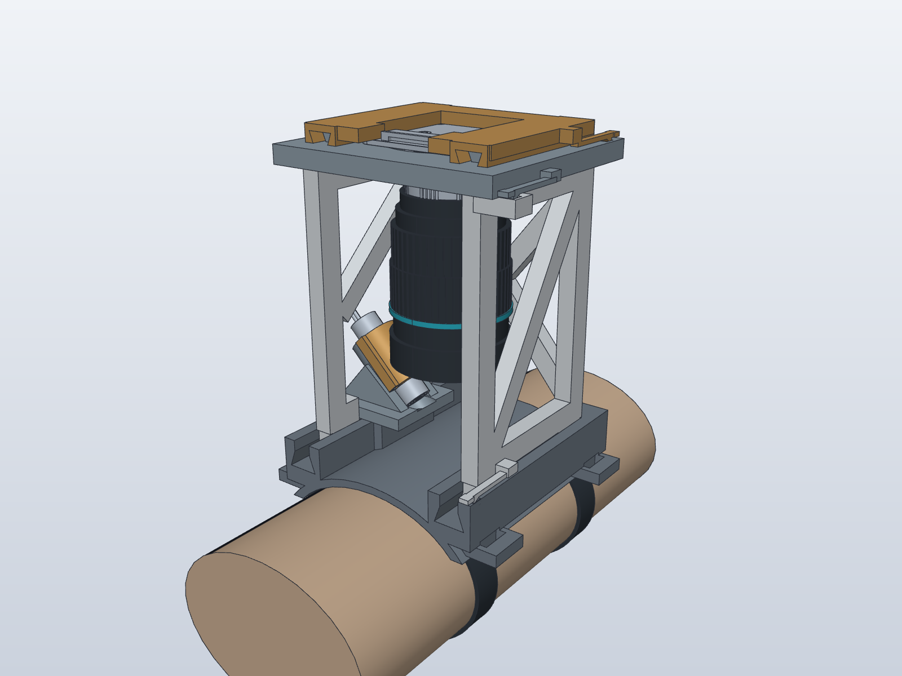
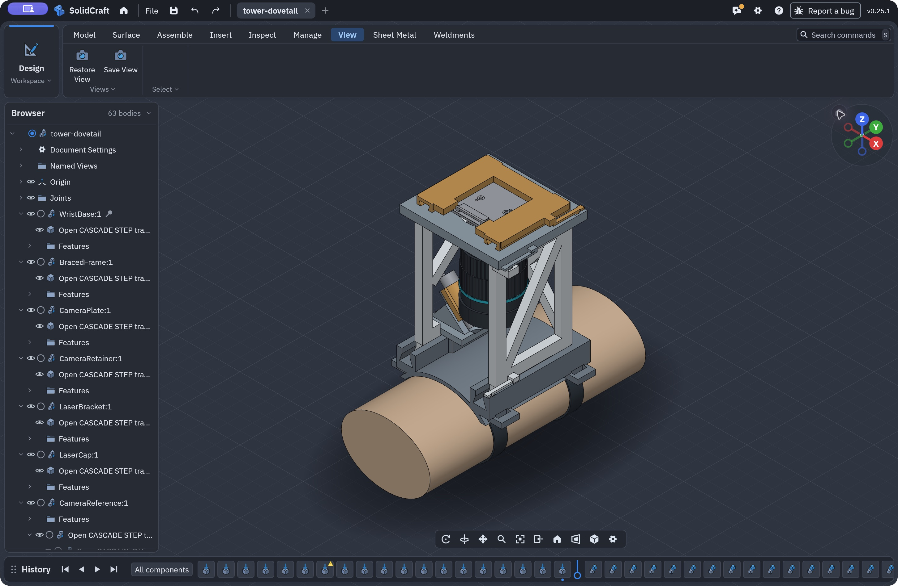
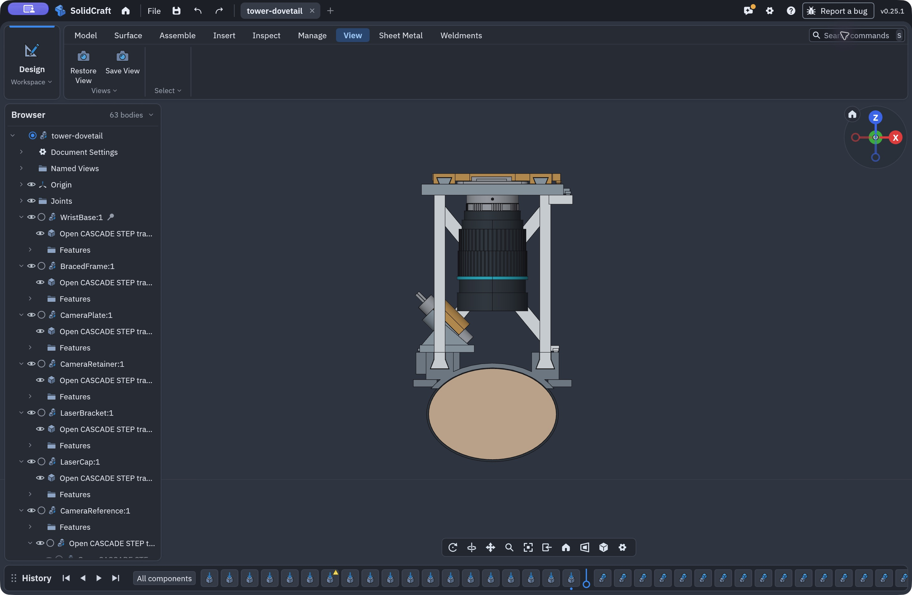
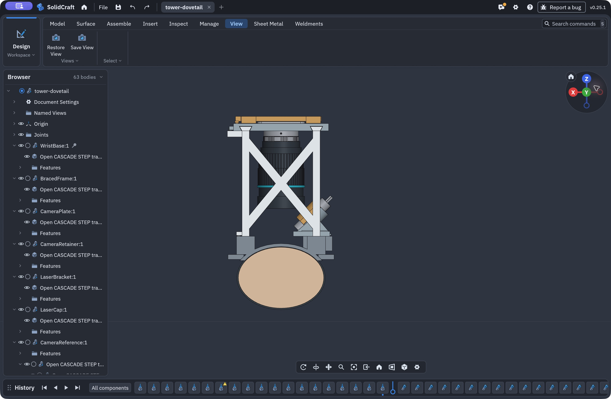
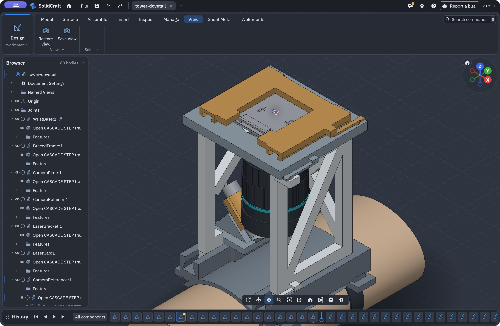
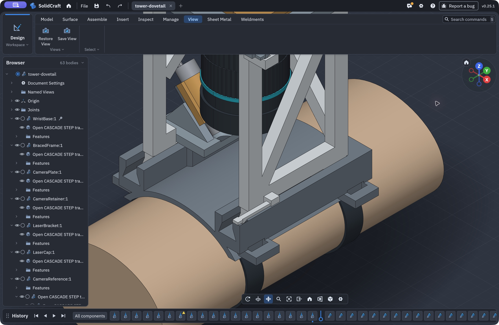
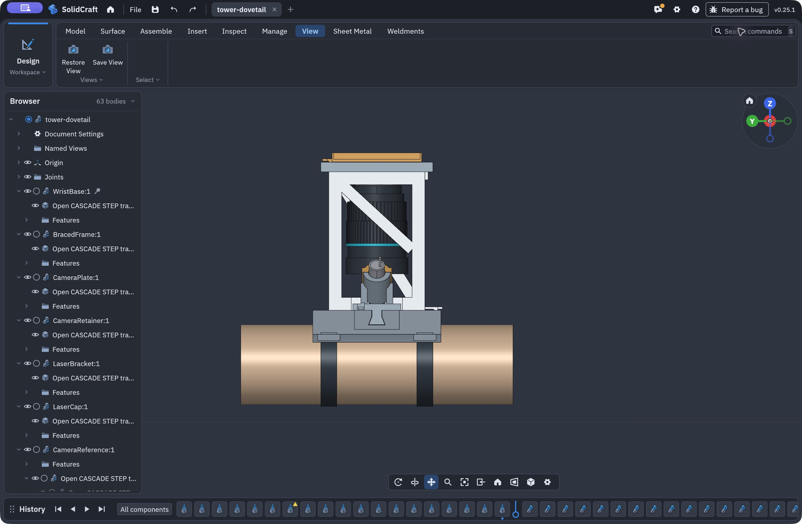

# Sliding Dovetail Wrist Tower

Pin-free revision of the mechanical tower. Six major printed parts remain; the twelve loose cross-pins and all locating pegs have been removed. Frame/base, plate/frame and retainer/plate joints use dovetail rails, blind end stops and integral lift-release tabs. The laser foot uses a lateral dovetail and integral tab; its cap uses miniature axial dovetails with a stop.



## How It Assembles

1. Slide the braced frame rearward into the two base tracks. Its rectangular necks and wider dovetail feet resist lift-out. The rear ends locate against stops; lift the right front release tab to withdraw it.
2. Slide the camera plate rearward onto the frame's two upper rails. Its right-side tab engages a separate catch.
3. Lower the complete camera/adapter/lens through the 42 mm opening from above, with the retainer removed.
4. Slide the U-shaped camera retainer **from the rear toward the front**. This direction keeps its rear bar from sweeping across the ribbon connector. Lift its rear release tab to remove it.
5. Assemble the laser and sliding cap off the tower, then slide the complete laser bracket into its base dock **from the left**. The dedicated lower frame bay leaves this path open. Lift the foot's release tab to remove it.

The laser was moved back/up along the same 45-degree axis to keep its lower cradle above the docking surface during entry. It still nominally aims at the wrist under the camera axis. The left side diagonal begins higher to leave the entire laser-entry bay clear; the right side diagonal and rear X brace remain.

The latch ramps intentionally contact their catch surfaces during engagement. They require approximately 1 mm of elastic deflection. This has **not** been physically or structurally validated in PLA. The laser cap has no separate positive latch: its axial stop and dovetail grip require a fit/retention test before powered or worn use.

## Fit Test First

`fit-coupon/` contains two small pieces extracted from the actual right-front frame/base joint, including its release tab and catch. It tests the real nominal 0.25 mm allowance per side. The cropped receiver has an open rear; it tests sliding fit and latch action, not the full assembly's rear stop.

- `MaleRailAndLatch.step` / `.stl`
- `FemaleRailAndCatch.step` / `.stl`

STLs have their minimum Z on the bed. They have not been sliced or validated for support placement. Test sliding force, tab release and repeated insertion before printing the whole tower. Clearance is a starting value, not a guarantee of fit on the A1 mini. Do not force a tight joint or repeatedly bend a whitening/cracked PLA tab.

## What Was Checked

`mechanical-check.json` records:

- All six major printed bodies are valid connected single solids.
- Zero nominal intersections between those bodies and the camera/PCB envelope, lens envelope, adapter, laser and wrist reference.
- Twenty-one samples of each frame, plate, retainer, laser-foot and cap insertion path, with no rigid-body collisions. Integral ramp teeth are excluded from these sliding-path checks because they must deflect. This is sampled geometric clearance, not a continuous sweep, latch simulation or force test.
- Eleven samples of the 100 mm vertical camera-loading path, with no collisions and the retainer removed.

`camera-surface-check.json` additionally checks the supplied camera's 515 source faces against the plate, including its open PCB shells. The fit coupon has its own `coupon-check.json`.

## Dimensions and Scope

The user-confirmed camera STEP has a 39 mm board and a 34 mm square hole pattern with 2 mm holes. The camera is supported by the carrier and retained around its edges; those holes are not used for printed fasteners.

The lens clearance model is a Ø39 × 50 mm cylinder plus a nominal 5.026 mm C-to-CS allowance. The visible rings are a dimensioned visual reconstruction from the [PiShop lens photo/specification](https://www.pishop.us/product/16mm-telephoto-lens-for-raspberry-pi-hq-camera-cs/), not exact supplier lens CAD. Adjustment knobs, thread engagement, focus travel and actual adapter dimensions still need measurement.

This retains the compact mechanical fit height: camera reference origin 104 mm above the nominal wrist, with about 31.8 mm between lens front and skin. The listed lens minimum object distance is 0.20 m. Useful focus and SCOS performance at this geometry remain unverified. The tower is not telescopic; optical height must be established experimentally before a complete print is released.

The earlier 0.20 kg / 3 g load scenario is retained as a design assumption in the check report. It is not a demonstrated capacity or FEA. Frame stiffness, PCB loading, dovetail play, spring-root strain, fatigue, cap grip, laser exposure and strap retention remain unvalidated.

## SolidCraft Screenshots

Captured from the assembled model in SolidCraft v0.25.1. Colors identify components; they do not prescribe filament colors.

| Overview | Front | Rear bracing |
|---|---|---|
|  |  |  |

| Camera retainer | Base dovetail | Laser side |
|---|---|---|
|  |  |  |

## Files

- `tower-dovetail.solidcraft`: assembly saved through SolidCraft MCP.
- `tower-dovetail.step`: portable assembly.
- `parts/`: named printed parts and hardware references, with no loose pins.
- `sources/`: camera, licensed Adafruit laser source and lens visualization references.
- `build.py`: explicit joint profiles, clearances, mating geometry and insertion checks.

Rebuilding requires [uv](https://docs.astral.sh/uv/) and SolidCraft with its `solidcraft-cli` executable. Set `SOLIDCRAFT_CLI` if it is not on PATH or installed at the default macOS application path. `build.py` runs the geometry checks and recreates the native assembly, STEP files, and model renders; run the coupon and camera surface scripts afterward.

```sh
uv run --python 3.12 --with cadquery python cad/tower-dovetail/build.py
uv run --python 3.12 --with cadquery python cad/tower-dovetail/make_fit_coupon.py
uv run --python 3.12 --with cadquery python cad/tower-dovetail/check_camera_surfaces.py
```

The current model has not been sliced or printed. This folder is the pin-free tower revision; the earlier pin-based study is not included here.
