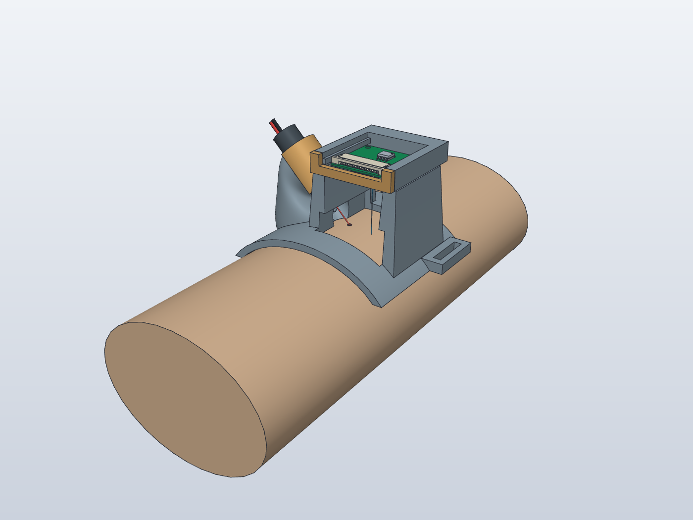
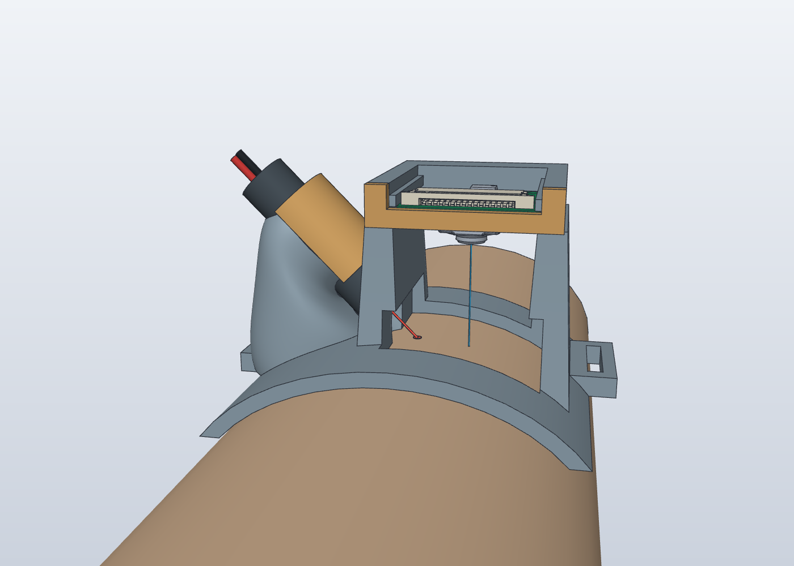
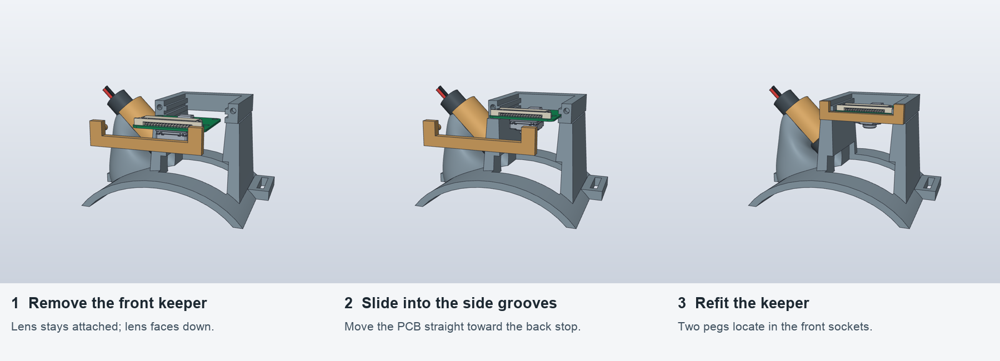
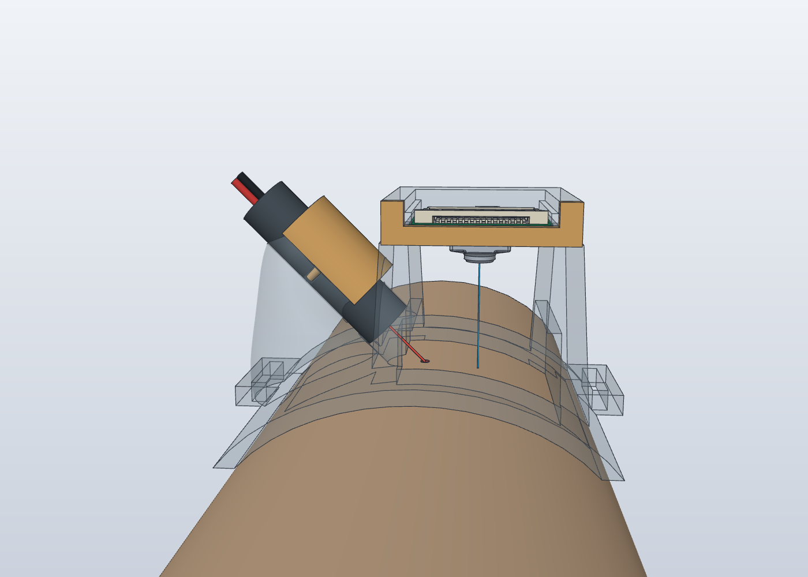

# Wrist-Mounted Camera and Laser Prototype

A one-sided wrist saddle for the official Raspberry Pi Camera Module 3 and Adafruit 1054 laser. The camera slides into two grooves with its stock lens attached. A removable front keeper retains the board. A broad loft forms the laser cradle's lower support, and a separate cap closes over the barrel. Both removable parts use printed locating pegs.





## Files

| File | Use |
| --- | --- |
| [SolidCraft assembly](wrist-inward.solidcraft) | View the assembly in SolidCraft; imported solids do not provide an editable feature timeline |
| [STEP assembly](wrist-inward.step) | Open in Fusion or another CAD tool; includes camera, laser, and arm references |
| [Black PLA print plate](print/wrist-mount-black-pla.3mf) | Three printed parts on one A1 mini plate, with slicing settings and G-code |
| [Individual STEP parts](parts/) | Saddle, laser cap, and camera keeper |
| [Oriented STL parts](print/stl/) | Same three parts, positioned on the bed |
| [Geometry checks](model-check.json) | Solid validity, assembly interference, and camera insertion checks |
| [Mesh checks](print/mesh-and-orientation-check.json) | Closed connected meshes and print orientations |
| [Plate checks](print/print-validation.json) | Settings, object count, and slicer results from the release 3MF |

Units are millimetres. The arm is a simple reference ellipse, not a measured wrist scan. Camera Module 3 Standard is the checked reference; the Wide model has not been checked. This mount does not accept the IMX296 Global Shutter Camera or its separate C/CS lens.

## Camera Installation



1. Remove the gold front keeper.
2. Point the integrated lens down and align both PCB edges with the grooves.
3. Slide the board horizontally toward the rear stop, without removing the lens.
4. Refit the keeper's two pegs into the front sockets. The low centre bar leaves the ribbon connector accessible.

Remove supports from the grooves and sockets first. Test gently: printed tolerances, retention, and ribbon installation ergonomics still need checking on the hardware.

## Laser Position

The aperture faces inward and down across the wrist, toward skin near the camera's viewing area. The red beam and blue camera axis below are explanatory geometry, excluded from the print. The nominal illumination point is 10 mm from the camera viewing centre; the beam is not aimed into the lens.



The cradle bore is 10.4 mm. The supplier STEP has a 32.8 mm barrel; physical fit against the delivered laser still needs checking. The laser cap is separate, so its seam remains visible. No filter holder or optical enclosure is included in this revision.

## Printing

Open `print/wrist-mount-black-pla.3mf` in Bambu Studio. It contains only the saddle, laser cap, and camera keeper. Camera, laser, arm, and ray references are excluded.

- Bambu A1 mini, 0.4 mm nozzle, black Generic PLA, textured PEI plate.
- 0.20 mm layers, four walls, 30% infill, build-plate-only tree supports.
- Saddle: flat end on the bed. Cap: annular end on the bed. Keeper: broad face on the bed.
- Approximately 1 h 46 min and 32.8 g including supports; estimates vary slightly with slicer version.

The black PLA job was sent to the A1 mini using AMS slot A1 on October 28, 2026. The checked-in plate can be sliced and printed again, but its saved colour does not verify what is physically loaded in an AMS slot. Check the mapping before sending another job.

## What Has Been Checked

The three printed shapes are valid single solids. Their meshes are watertight, have consistent normals, and each contain one connected component. Bambu Studio slices all three on one plate within the A1 mini build area.

The CAD check found zero nominal intersections between the saddle and wrist, laser, cap, keeper, or beam. It also checked the complete official camera source (590 solids) using conservative bounding boxes swept continuously over a 35 mm insertion path, against the saddle, laser, and cap, with the keeper removed. No intersections were found.

These are geometry and slicer checks. Hardware fit, grip, support removal, stiffness, repeated placement, laser-cap insertion motion, skin exposure, and optical performance have not been validated. The lens is about 20 mm above the skin reference. Useful SCOS measurements at that distance remain unverified; this is a packaging and fit prototype, not a validated blood-flow sensor. Follow the project's [laser handling guidance](../../docs/HARDWARE.md) before powered testing.

## Rebuilding

Requires `uv`, SolidCraft with `solidcraft-cli`, and Bambu Studio for slicing. The curved solids are built with CadQuery/Open CASCADE, then imported, saved, and rendered through an isolated SolidCraft MCP session.

From the repository root:

```sh
python3 cad/wrist-architecture/fetch_sources.py
uv run --python 3.12 --with cadquery python cad/wrist-architecture/build.py
uv run --python 3.12 --with cadquery --with pillow python cad/wrist-architecture/show_insertion.py
uv run --python 3.12 --with cadquery --with trimesh python cad/wrist-architecture/prep_print.py
python3 cad/wrist-architecture/check_plate.py
```

`fetch_sources.py` downloads the official Standard camera STEP and verifies a pinned SHA-256. The large source is ignored by Git. `build.py` creates display references from that same source and uses every source solid for insertion checking. `prep_print.py` reads installed Bambu A1 mini profiles and generates the one-plate project locally; it does not send a job. On other platforms, adjust the Bambu application/profile paths in that script. Set `SOLIDCRAFT_CLI` if the CLI is not on PATH or at the macOS fallback path.

## Reference Models

- Raspberry Pi: [official Camera Module 3 STEP archive](https://datasheets.raspberrypi.com/camera/camera-module-3-step.zip). The display retains the board, integrated lens housing, ribbon connector, and major details; tiny passives are omitted from display only. The camera geometry embedded in the assemblies is reference material from Raspberry Pi.
- Adafruit: [1054 laser module](https://www.adafruit.com/product/1054), supplier model from [Adafruit CAD Parts](https://github.com/adafruit/Adafruit_CAD_Parts). See [the included MIT licence](sources/Adafruit_LICENSE.txt).

Related work: [mounting issue #10](https://github.com/ebf-hue/mini-scos/issues/10). Repeated-placement and optical measurements remain outstanding.
